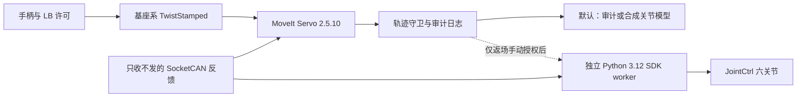

# PiPER：MoveIt Servo 与最小 SDK 桥接

## 2026-10-30 实机恢复更新（当前状态）

用户已确认低速 X/Y/Z 手柄平移恢复，仍有轻微抖动；尚未完成夹爪/相机/数据采集联调。下面 10 月 23 日内容是历史记录，不再代表当前三轴运动状态。详见 [恢复报告](servo_bridge/validation/20261030/REPORT.md)。

本次新增 `--execution-mode integrated-velocity`：把 Servo 速度平滑、限加速度后积分为 SDK 连续位置目标。必须显式选用；省略时仍是旧 `servo-position` 对照模式。六关节状态及固件末端位置可以只读查看：

```bash
conda activate lerobot
cd /home/eureka/piper_ws/smolvla_deploy
python -m servo_bridge.inspect_state --samples 10
```

假定 CAN 已 UP/1Mbps、实机已 CAN/MOVE_J 且六关节使能，并按下文现场授权流程更新 `outputs/servo_bridge/arm.local.json`（临时测试文件已过期，不能直接重用）：

```bash
# 终端 A：SDK worker，使用 lerobot 环境
python -m servo_bridge.sdk_worker --execute \
  --arm-file outputs/servo_bridge/arm.local.json

# 终端 B：系统 ROS 环境由 run.sh 隔离设置
cd /home/eureka/piper_ws/smolvla_deploy
bash servo_bridge/run.sh --source can --input gamepad \
  --gamepad-config gamepad.local.servo.json \
  --execution-mode integrated-velocity --duration 60 \
  --output-socket /tmp/piper-servo-sdk.sock \
  --output outputs/servo_bridge/my_recovered_001
```

先回中，持续按 LB 才运动；左摇杆前后控制基座 X、左右控制 Y，右摇杆上下控制 Z；RB 为精细速度。松开 LB 请求实测位置保持。先退出终端 B，再退出 A。程序不负责自动使能/回零/切模式/夹爪。输出目录需使用新名字。

不接实机输出的完整模拟：

```bash
bash servo_bridge/run.sh --source sim --duration 18 \
  --execution-mode integrated-velocity \
  --output outputs/servo_bridge/my_integrated_sim_001
```

回退：停止两个进程后，把 `--execution-mode` 改为 `servo-position` 即为旧桥接对照；不要在同一 CAN 上同时运行旧遥操作与新 worker。新路线尚未接入采集 UI，不能同时启动会发动作的旧采集控制器。

## 2026-10-23 实机返场测试更新

**当前位置保持已由用户确认通过；Cartesian 手柄平移未通过，仍不能用于示教采集。** 手柄和 CAN 输入正常，在条件数约 15 的姿态下，Servo 未报奇异性；但桥接加速度检查拒绝目标，执行跟踪不足，后续输入租约超时。详见 [本次实机报告](servo_bridge/validation/20261023/REPORT.md)。

已修复首次拒绝后显式停止并锁定输出、LB 独立释放通知和 Ctrl-C 日志清理。26 项测试及纯模拟中断检查通过，**这些修复尚未在实机运动中复测，也不代表平移恢复**。未放宽限速/加速度/跟踪差/奇异性阈值。临时输出授权已撤销，所有本次写入进程已退出。

本机系统 ROS SDL 使用 `gamepad.local.servo.json`；旧 Conda SDL 使用 `gamepad.local.teleop.json`，两者 GUID 不同，保留各自配置。下文是最初接入说明，最初“本次未连接实机”的描述对应 10 月 19 日，当前状态以本节和 10 月 23 日报告为准。


2026-10-19。代码已接入现有仓库，旧 `e14.gamepad_control`、配置和数据格式保留。当前默认运行路径只审计或驱动合成关节模型，**实机输出关闭**。本次没有发送实机运动、使能、夹爪、复位或模式切换指令。

**这还不能证明实机 Cartesian 问题解决。** 同一故障日志在 MoveIt 中触发奇异性停止；不能在原姿态直接打开输出后期待恢复。先看 [验证报告](servo_bridge/validation/20261019/REPORT.md)。

## 这套接入做了什么



- ROS 使用 Ubuntu 22.04 的系统 Python 3.10、ROS 2 Humble。`run.sh` 在子进程中清理 Python 路径并设置 ROS，不更改 `.bashrc`、Conda 包或调用终端的环境。
- Cartesian 转换交给实际运行的 MoveIt Servo C++ 节点；没有调用旧的 NumPy DLS。未配置 IK 插件时，Humble Servo 使用它自己的逆 Jacobian 路径，这条启动警告属于预期行为。
- 纯平移时保留启动 LB 时的朝向参考，加入有误差带、限幅、抗积分饱和的角速度纠偏。停止状态冻结参考推进，不要求每 50 ms 消除全部姿态误差。
- Servo 周期 50 ms，线速度上限沿用低速对照的 0.01 m/s，角速度 0.05 rad/s；未为通过测试加速。RB 是 1/4 精细速度；先松开 LB 并回中，再按住 LB 运动。
- 保留 Servo 示例的奇异性阈值 **17 / 30**、碰撞检查及 0.1 rad 关节限位裕量。没有设置速度比例覆盖来绕过检查。
- 守卫检查名称重排、弧度、SDK 的 0.001° 整数量化、位置限位、反馈/输入新鲜度、轨迹时间、1° 目标步长与跟踪差、0.15 rad/s 速度和 0.5 rad/s² 声明速度变化率；拒绝不合格目标，不静默裁剪。限位取当前配置与 URDF 的交集，J6 保留 ±120°。
- 输出轨迹的 `header.stamp=0` 是 Humble Servo 的“立即开始”约定。守卫依靠新鲜输入租约与测量反馈检查时效，不把 0 当作 Unix 时间，也不把接收时间伪装成 Servo 生成时间。
- SDK worker 与 ROS 通过本机 Unix datagram 通信。它独立读真实 CAN、重复检查许可和约束；不导入 ROS/SciPy，不调用 `prepare_control()`、`EnableArm()`、模式、复位、夹爪或软急停。SDK 连接显式 `piper_init=False, start_thread=False`，禁止默认初始化查询。
- 新路线暂不提供夹爪操作、相机窗口或采集 UI。先完成六关节示教底座验证；旧采集接口保留，不能把合成反馈、回放或候选目标当成真实训练数据。

## 安装与模型

本机已安装 MoveIt Servo 2.5.10 及所需系统依赖。复现安装可显式执行：

```bash
cd /home/eureka/piper_ws/smolvla_deploy
bash servo_bridge/install_ros_dependencies.sh
```

模型沿用已固定版本的 Gamepad_PiPER URDF，以便与旧控制器比较；SRDF 的 arm 链与碰撞排除对参考 PiPER 官方 Humble 配置。生成过程只修改资源路径和关节限制，不修改几何链。全部 STL 进行 SHA-256 校验。

本机已有上游参考目录，可以离线生成：

```bash
cd /home/eureka/piper_ws/smolvla_deploy
PYTHONNOUSERSITE=1 /usr/bin/python3 -m servo_bridge.prepare \
  --mesh-source /home/eureka/piper_ws/_references/Gamepad_PiPER/piper/meshes \
  --output models/piper_servo
```

其他电脑先下载固定 commit 的网格，再生成：

```bash
PYTHONNOUSERSITE=1 /usr/bin/python3 -m servo_bridge.fetch_meshes
PYTHONNOUSERSITE=1 /usr/bin/python3 -m servo_bridge.prepare \
  --mesh-source models/piper_servo_mesh_source --output models/piper_servo
```

生成物位于 `models/piper_servo/`，Git 忽略；资源清单记录模型/网格哈希。迁移仓库后重新生成，不能把包含旧绝对网格路径的 `params.yaml` 直接搬到另一台机器。

## 现在可运行：模拟与审计

不需要激活 Conda。即使当前终端处于 `(lerobot)`，`run.sh` 也会使用系统 ROS Python。

```bash
cd /home/eureka/piper_ws/smolvla_deploy
bash servo_bridge/run.sh --source sim --duration 18 \
  --output outputs/servo_bridge/my_sim_001
```

这是**限速的一阶合成关节模型**，用于验证接口、连续前进和故障阻断，未模拟 PiPER 固件、动力学或物体接触。自动输入依次测试 X、Y、Z、Yaw 与松开 LB。输出目录必须为新目录，复测请改编号。

可另开终端看 RViz（不需要 MoveGroup 或 Plan/Execute）：

```bash
source /opt/ros/humble/setup.bash
ROS_DOMAIN_ID=83 ROS_LOCALHOST_ONLY=1 rviz2 \
  -d /home/eureka/piper_ws/smolvla_deploy/servo_bridge/piper_servo.rviz
```

它显示 `/piper_servo/joint_states` 对应的合成或回放状态，不能据此判断实机运动。当前 RViz 配置已写好，GUI 显示还需现场打开核对。

用真实故障日志回放（不打开 CAN，不运行 SDK）：

```bash
bash servo_bridge/run.sh --source log \
  --log outputs/teleop_trace/20261019-171623-165f8a4e.jsonl \
  --output outputs/servo_bridge/my_replay_001
```

回放保持记录的反馈和输入时序，约 83 秒；有规划数据时使用记录的规划前角度。日志间隔有变化，Servo 自己按 20 Hz 输出，所以输入记录数与轨迹数不同。

故障测试：

```bash
bash servo_bridge/run.sh --source sim --scenario collision --duration 6 \
  --output outputs/servo_bridge/my_collision_001
bash servo_bridge/run.sh --source sim --scenario timeout --duration 6 \
  --output outputs/servo_bridge/my_timeout_001
```

奇异性测试配置使用验证目录保存的原故障姿态：

```bash
bash servo_bridge/run.sh --source sim --scenario singularity --duration 6 \
  --config servo_bridge/validation/20261019/singularity_config.json \
  --output outputs/servo_bridge/my_singularity_001
```

同一 ROS 域只允许本程序一个实例，避免合成状态与真实反馈混入。确需并行离线测试时使用不同 `ROS_DOMAIN_ID`；实机侧只保留一个经过核对的域和一个 CAN 写入者。

## 在哪里看数据

每次运行保存到 `--output`：

| 文件 | 内容 |
|---|---|
| `events.jsonl` | 输入、反馈来源/角度、FK、朝向参考、条件数、Servo 状态、候选轨迹、拒绝原因、时序与 CPU 汇总 |
| `servo_node.log` | 实际 MoveIt C++ 节点的诊断 |
| `robot_state_publisher.log` | 模型和 TF 发布诊断 |
| `ros_logs/` | ROS 运行日志 |

汇总命令：

```bash
PYTHONNOUSERSITE=1 /usr/bin/python3 -m servo_bridge.metrics \
  outputs/servo_bridge/my_sim_001/events.jsonl \
  outputs/servo_bridge/my_replay_001/events.jsonl \
  --output outputs/servo_bridge/my_metrics.json
```

`accepted=true` 表示通过软件候选检查，**不表示发送到了实机或实机执行成功**。`status=2` 为奇异性停止，4 为碰撞停止，5 为关节边界；状态话题与轨迹话题异步，日志记录的是最近收到的状态，不是严格一一对应的 Servo 内部计算编号。

日志回放是开环反事实审计：真实反馈不会因新的候选动作改变。候选目标的步长/加速度问题必须记录，但不能据此推断实际闭环一定怎样。合成闭环也不证明固件对微小绝对位置目标的跟踪已经解决。

## 用户返场后：最小实机验证

此次没有检测到 `can0`，不能完成现场核对。以下步骤留给用户在场时执行；本次未执行。

1. 确保旧运动脚本已退出。机械臂保持支撑/固定、夹爪空载并有活动余量。按既有现场流程退出实体示教、选择 CAN/MOVE_J、使能；新路线不会替你完成这些操作。不要复位或回零。
2. 先只读。CAN 应已处于 UP / 1 Mbps；新路线不会启动或重启接口：

```bash
ip -details link show can0
bash servo_bridge/run.sh --source can --input none --duration 10 \
  --output outputs/servo_bridge/passive_001
```

3. 核对六关节顺序、正方向、固件的偏置约定与 `base_link → link6`。`link6` 是法兰，**不是夹爪指尖/腕相机**。当前模型夹爪总行程只有 70 mm，若反馈超过 70 mm 会拒绝；需要核实正确型号/行程模型，或现场把夹爪置于已核对的模型范围，不能假定 100 mm 可直接映射成 70 mm。确认相机支架、桌面与工具几何后再规划接近桌面的任务。
4. 保持输出关闭，接上真实手柄，只检查 Twist 方向和状态：

```bash
bash servo_bridge/run.sh --source can --input gamepad \
  --gamepad-config gamepad.local.teleop.json --duration 60 \
  --output outputs/servo_bridge/passive_pad_001
```

5. 若姿态仍触发奇异性停止，先在现场调整到有余量的弯曲姿态，重新做只读核对。不要照抄合成模型的初始角度自动运动，也不要提高阈值来绕过停止。
6. 用独立 SDK worker 做“一次当前关节目标保持”测试，再确认停止策略适用于本次接入。该测试只发一次六关节当前位置目标，观察 2 秒，不自动使能/切模式/开合爪。需要现场临时授权文件，见下文。
7. 保持测试通过后，确认松开 LB、输入中断、程序退出和反馈丢失时的行为。第一次平移仅在一个方向上低速执行约 1 秒，观察是否持续前进并保持朝向；依次 X/Y/Z，再小角度旋转。先核对相邻周期轨迹、实际角度和实际速度，再延长时间或采集数据。

### 输出授权与两个 Python 环境

**仓库没有已授权文件。** `arm.example.json` 的确认项均为 false、期限为 0；复制后不编辑仍会被拒绝。不要提前预填确认项，也不要把文件放入 Git。授权最长 30 分钟。

现场复制到已忽略的目录：

```bash
mkdir -p outputs/servo_bridge
cp servo_bridge/arm.example.json outputs/servo_bridge/arm.local.json
```

只有现场操作者核对完对应项目后，才设置 `operator_present`、`model_and_control_point_checked`、`only_one_can_writer`。`expires_unix_s` 填未来最多 30 分钟的 Unix 秒，可通过 `date +%s` 获取当前值。首次保持测试允许 `measured_joint_hold_checked=false`；连续遥控必须在实际确认保持后再改为 true。

下面两类 worker 命令都属于**会发送关节指令的现场步骤**，不是只读检查；本次没有运行它们。

```bash
# 终端 A：使用原 LeRobot 环境；先做一次当前位置保持，然后退出
conda activate lerobot
cd /home/eureka/piper_ws/smolvla_deploy
python -m servo_bridge.sdk_worker --execute --commission-hold \
  --arm-file outputs/servo_bridge/arm.local.json
```

现场确认保持稳定后，再更新对应确认项并在终端 A 启动 worker：

```bash
python -m servo_bridge.sdk_worker --execute \
  --arm-file outputs/servo_bridge/arm.local.json
```

终端 B 才连接实际输出：

```bash
cd /home/eureka/piper_ws/smolvla_deploy
bash servo_bridge/run.sh --source can --input gamepad \
  --gamepad-config gamepad.local.teleop.json --duration 60 \
  --output-socket /tmp/piper-servo-sdk.sock \
  --output outputs/servo_bridge/supervised_001
```

worker 独立验证：当前已经为 CAN/MOVE_J、六电机使能、健康且反馈新鲜；不满足则拒绝，不自动修复。只有 `--source can --input gamepad` 可连接 worker，回放或合成输入不允许连接输出。

SDK `JointCtrl` 将分成三个 CAN 帧发送，并不提供“电机已经到位”的执行确认；部分发送错误只写 SDK 日志。这个最小桥接不能替代固件跟踪验证。记录中的候选通过、SDK 函数返回和实机达到目标应分别判断。

### 停止与回退

- 默认模拟/只读运行按 **Ctrl+C**，只关闭本程序启动的 ROS 进程；不发送实机停止、失能或其他清理指令。
- 现场输出模式松开 **LB**，worker 在收到释放/停止条件且反馈可靠时，按已确认策略发送一次实测关节保持。输入租约为 150 ms；断链会退出 worker。Servo 停止/碰撞/关节边界会锁住输出，需现场排查后重新启动，不自动恢复。
- 现场按 worker 终端 **Ctrl+C** 同样请求上述保持后关闭连接。若反馈丢失/故障，软件不能验证位置保持，会关闭写入并报错；现场必须使用已验证的硬件停止流程。这里没有使用会导致阻尼下落的 `MotionCtrl_1` 软急停。
- 也可在隔离的 ROS 环境调用 `ROS_DOMAIN_ID=83 ROS_LOCALHOST_ONLY=1 ros2 service call /servo_node/stop_servo std_srvs/srv/Trigger '{}'`；这是停止 Servo 计算，不能当作硬件急停。
- 回退前先退出新路线的 runtime 和 worker，再使用原来的 `e14.gamepad_teleop` 和 `config.local.teleop.json` / `gamepad.local.teleop.json`。本次未更改旧控制逻辑或这些配置，也未修复旧实机 Cartesian 问题；回退只是保留对照。单独验证旧 joint 模式可按 [常用命令](常用命令.md) 操作，不能新旧同时写 CAN。
- 无需卸载系统 MoveIt 或改 Conda 来回退。授权文件过期后保留关闭状态；下次现场重新检查并授权。

## 测试与后续工作

系统 ROS 测试：

```bash
source /opt/ros/humble/setup.bash
PYTHONNOUSERSITE=1 /usr/bin/python3 -m unittest discover -s servo_bridge/tests -v
```

旧仓库测试仍在 LeRobot 环境运行：`python -m unittest discover -s tests -q`。两套依赖分离，不要为了运行 ROS 测试向 LeRobot 加入 ROS Python 路径。

本次已验证：实际 Servo 运行、真实日志回放、合成闭环、故障阻断、消息/单位/时间/默认关闭契约。待验证：实机微小绝对位置目标跟踪、首次保持/退出行为、正确夹爪模型、夹爪操控、工具/相机/桌面标定，以及采集 UI 与新路线的联调。近期继续用最小 SDK 桥接，长期可迁移到标准 ROS 驱动与 ros2_control 控制器，进一步统一反馈、速度/插补与停止语义。

参考：[Humble Servo 官方教程](https://moveit.picknik.ai/humble/doc/examples/realtime_servo/realtime_servo_tutorial.html)、[Humble Servo 输出时间语义源码](https://github.com/moveit/moveit2/blob/humble/moveit_ros/moveit_servo/src/servo_calcs.cpp)、[PiPER 官方 SRDF](https://github.com/agilexrobotics/piper_ros/blob/humble/src/piper_moveit/piper_with_gripper_moveit/config/piper.srdf)、[固定版本 Gamepad_PiPER](https://github.com/kehuanjack/Gamepad_PiPER/tree/aa00c80e100d687a5f4a386b79b83ece06b3a30f)。


## Servo 手柄采集入口

已接入 `python -m e14.collect_data --teleop servo`，含实时相机预览、录制/标注和独立控制进程。详见 [SERVO_COLLECTION.md](SERVO_COLLECTION.md)。本轮仅离线测试；夹爪与自动返回尚未接入。
